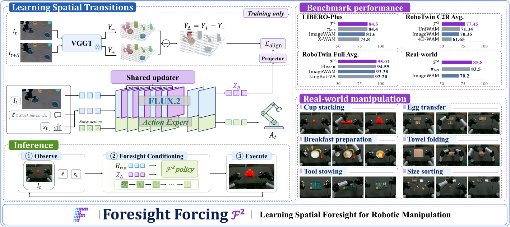

# Foresight Forcing

### Learning Spatial Foresight for Robotic Manipulation

Mishuo Han, Zhixuan Liang, Zhaoyuan Wan, Wendi Chen, Jiarui Chen, Xinkai Wang, Yue Ma, Yu Zhou, Junting Chen, Yao Mu, Jun Lv, Chuan Wen, and Cewu Lu

[Paper](https://arxiv.org/abs/2611.30963) · [Project Page](https://anson2333.github.io/foresight-forcing/) · [Models](https://huggingface.co/anson233/foresight-forcing) · [Quick Start](#quick-start) · [Evaluation](#evaluation) · [Training](#training) · [Citation](#citation)

Foresight Forcing is a World Action Model that learns **spatial transition queries** from correspondence-aligned changes in a pretrained 3D feature space. During training, a frozen 3D teacher provides dense supervision for anticipated geometric transitions. At deployment, the policy predicts these queries directly from the current observation, language instruction, and proprioceptive state—without future observations or the 3D teacher.

<p align="center">
  
</p>

## Highlights

- **Spatial foresight for action generation.** The policy represents task-relevant geometric transitions with spatial queries and uses them together with current visual features to generate actions.
- **Training-only 3D supervision.** Correspondence-aligned feature changes from a frozen VGGT teacher supervise the transition pathway without adding the teacher to deployment.
- **Strong manipulation performance.** Foresight Forcing reaches 98.5% on LIBERO, 84.5% on LIBERO-Plus, and 95.01% average success on RoboTwin 2.0 Full.

| Benchmark | Protocol | Result (%) |
| :-- | :-- | --: |
| LIBERO | Four-suite average | **98.5** |
| LIBERO-Plus | Overall across seven perturbations | **84.5** |
| RoboTwin 2.0 Full | Clean / Randomized / Average | **94.90 / 95.12 / 95.01** |
| RoboTwin 2.0 Clean-to-Random | Clean / Randomized / Average | **87.84 / 67.06 / 77.45** |

## Checkpoints

Released checkpoints are available from [Hugging Face](https://huggingface.co/anson233/foresight-forcing):

```bash
huggingface-cli download anson233/foresight-forcing \
  --local-dir checkpoints/foresight-forcing
```

## Quick Start

Clone the repository with its pinned VGGT submodule and create the Python 3.11 environment:

```bash
git clone --recurse-submodules https://github.com/anson2333/ForesightForcing.git
cd ForesightForcing
git submodule update --init --recursive
uv sync --python 3.11 --extra shared
source .venv/bin/activate
cp .env.example .env.local
```

Prepare the pinned FLUX.2 source checkout:

```bash
git clone https://github.com/black-forest-labs/flux2 third_party/flux2
git -C third_party/flux2 checkout 50fe5162777813d869182b139e83b10743caef15

export FLUX2_SRC=$(pwd)/third_party/flux2
export FLUX2_MODEL_PATH=/path/to/flux-2-klein-base-4b.safetensors
export FLUX2_AE_MODEL_PATH=/path/to/ae.safetensors
export FLUX2_QWEN3_MODEL_SPEC=Qwen/Qwen3-4B
```

The VGGT submodule is pinned to `a288dd0f14786c93483e45524328726ab7b1b4ce`. Model files should be obtained separately under their respective licenses.

Set local paths in the shell or `.env.local`:

```bash
export DATA_ROOT=/path/to/datasets
export MODEL_ROOT=/path/to/model/checkpoints
export OUTPUT_ROOT=$(pwd)/runs
```

## Data Preparation

Download the preprocessed benchmark datasets:

```bash
huggingface-cli download yuanty/LIBERO-fastwam \
  --repo-type dataset --local-dir data/libero_mujoco3.3.2

huggingface-cli download yuanty/robotwin2.0-fastwam \
  --repo-type dataset --local-dir data/robotwin2.0
(cd data/robotwin2.0 && cat robotwin2.0.tar.gz.part-* | tar -xzf -)
```

```bash
# LIBERO / LIBERO-Plus
export DATA_ROOT=$(pwd)/data/libero_mujoco3.3.2

# RoboTwin 2.0
export DATA_ROOT=$(pwd)/data/robotwin2.0
export ROBOTWIN_ROOT=$DATA_ROOT/robotwin2.0
```

RoboTwin is not vendored in this repository. Point to an external checkout and install its runtime environment:

```bash
export ROBOTWIN_REPO_ROOT=/path/to/RoboTwin
bash scripts/setup/install_robotwin_env.sh
```

## Evaluation

Set the checkpoint, dataset statistics, and number of evaluation GPUs:

```bash
export CKPT_PATH=/path/to/checkpoint.pt
export DATASET_STATS_PATH=/path/to/dataset_stats.json
export NUM_GPUS=8
```

Run the corresponding benchmark launcher:

```bash
# LIBERO
FLUX2_VARIANT=4b bash scripts/flux2/run_eval_flux2_libero.sh

# LIBERO-Plus
FLUX2_VARIANT=4b bash scripts/flux2/run_eval_flux2_libero_plus.sh

# RoboTwin 2.0
export ROBOTWIN_REPO_ROOT=/path/to/RoboTwin
FLUX2_VARIANT=4b bash scripts/flux2/run_eval_flux2_robotwin.sh
```

The RoboTwin evaluator supports both the 50-task Full setting and Clean-to-Random evaluation. For the 16D action contract, use `scripts/flux2/run_eval_flux2_robotwin_ee16.sh`; do not mix its checkpoints with the standard 14D entrypoint.

## Training

The standard launcher uses the FLUX.2 4B configuration and enables the spatial transition pathway by default.

```bash
# LIBERO / LIBERO-Plus
export DATA_ROOT=$(pwd)/data/libero_mujoco3.3.2
GPU_PER_NODE=8 \
TASK_TYPE=libero \
FLUX2_VARIANT=4b \
PRECOMPUTE_QWEN3_CACHE=true \
bash scripts/flux2/run_train_flux2_klein_imagewam.sh

# RoboTwin 2.0
export DATA_ROOT=$(pwd)/data/robotwin2.0
export ROBOTWIN_ROOT=$DATA_ROOT/robotwin2.0
GPU_PER_NODE=8 \
TASK_TYPE=robotwin \
FLUX2_VARIANT=4b \
PRECOMPUTE_QWEN3_CACHE=true \
bash scripts/flux2/run_train_flux2_klein_imagewam.sh
```

Useful overrides include `ZERO_STAGE`, `ACTION_INIT`, and `QWEN_CACHE_DIR`. If `ACTION_INIT` is omitted, the launcher creates compatible ActionDiT initialization weights automatically.

## Repository Structure

```text
configs/                  Hydra model, data, and task configurations
experiments/              LIBERO and RoboTwin evaluation integrations
scripts/                  Training, evaluation, and setup entrypoints
src/imagewam/             ImageWAM and Foresight Forcing implementation
third_party/vggt/         Pinned VGGT submodule
```

## Citation

If you find this work useful, please consider citing:

```bibtex
@article{han2026foresight,
  title   = {Foresight Forcing: Learning Spatial Foresight for Robotic Manipulation},
  author  = {Han, Mishuo and Liang, Zhixuan and Wan, Zhaoyuan and Chen, Wendi and Chen, Jiarui and Wang, Xinkai and Ma, Yue and Zhou, Yu and Chen, Junting and Mu, Yao and Lv, Jun and Wen, Chuan and Lu, Cewu},
  journal = {arXiv preprint arXiv:2611.30963},
  year    = {2026}
}
```

## Acknowledgements

This repository builds on [ImageWAM](https://github.com/AnjieCheng/Implicit-World-Models), [VGGT](https://github.com/facebookresearch/vggt), and [FLUX.2](https://github.com/black-forest-labs/flux2). We thank the authors for releasing their work.

## License

See [LICENSE](LICENSE).
